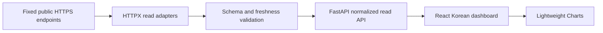

# Architecture and delivery boundaries

**Current delivery:** Phase2A PARTIAL + qualified manual PAPER + Phase4 local native research/synthetic automation. [Executed scope and evidence](qa/phase4/README.md). The initial plan below is historical; current supplements at the end describe implementation.

## Historical initial architecture

Status: Phase 1 research/design for the Phase 2 public market dashboard, reviewed 2026-10-30 UTC. This is intended architecture, not an implementation or validation report. The [design specification](superpowers/specs/2026-10-31-multi-exchange-trader-design.md) and [implementation plan](superpowers/plans/2026-10-31-public-market-dashboard.md) govern delivery. [Research](OPEN_SOURCE_AUDIT.md) and [exchange evidence](EXCHANGE_CAPABILITIES.md) explain the selections and unknowns.

## Phase 2 data flow

The backend is Python 3.12 with FastAPI, Pydantic and async HTTPX. The browser uses React, TypeScript, Vite and locally installed Lightweight Charts 5.2.1 with visible TradingView attribution. A Vite development proxy routes local `/api` requests to the backend. One API process and one frontend process suffice; no database, queue, container, worker, account service or paid hosting is required for this scope. Persistent storage is deferred. These dependencies and run commands still require implementation/lockfile verification.

HTTPX adapters are deliberately small: fixed public HTTPS hosts/routes, explicit venue/product/symbol mappings and response parsers. They have no API-key fields, signing, private account access or order methods. CCXT MIT is a possible future breadth option, with Pro WebSockets under separate terms; it is not an initial dependency. Official venue SDK capabilities are research evidence, not imports or enabled app features.

The normalized contract retains exchange, application symbol, spot/perpetual market type, source, observation timestamp and fetch timestamp. Tickers must carry finite positive decimal-safe prices. Candles carry UTC time, OHLCV and completion state; validate nonnegative volume, finite values, OHLC consistency, ascending times, duplicates and supported intervals. Preserve native symbols in mapping/provenance without presenting a spot symbol as a derivative. An observation time inferred from server/fetch time must be identified accurately; never invent a trade timestamp.

The proposed local routes are health, ticker and candles under `/api/v1`. Venue and symbol selection are enums/allowlists, not URL inputs. The API must map provider timeouts, throttling and malformed responses into safe typed errors. Use request deadlines, bounded response sizes/concurrency, application polling budgets and bounded retries. Never disable TLS verification. A provider error must preserve an earlier observation's actual age or display an unavailable state; do not silently substitute another venue.

Candidate venues are Binance Spot/USD-M perpetual and Bybit Spot/linear perpetual for BTC/ETH USDT instruments. The [endpoint gate](EXCHANGE_CAPABILITIES.md#endpoint-evidence-and-enablement-gate) distinguishes source review from connectivity. **OKX stays disabled until official V5 routes, schemas, limits, instrument mappings and candle semantics are verified.** An unavailable selector/data panel must explain that state. No guessed exchange request or network-policy bypass is allowed. Initial transport is REST polling; WebSockets await separate proxy/TCP qualification.

The Korean UI must show venue, instrument, market type, observation time, data age, loading/error/stale states, and `공개 시세 전용 · PAPER 엔진 미구현`. No balances, account positions, returns, win rates or model scores exist. An optional `preview=1` sample must show `샘플 데이터 · 실제 시세 아님` persistently; preview is off by default. Synthetic records never stand in for failed live observations. Existing manual Bybit positions are external and unmanaged.

## Future engine boundary

**NautilusTrader is the single selected execution/backtesting engine** for the full product. The current candidate is v1.231.0, whose GitHub release metadata is non-prerelease but whose title says “Beta.” Its inspected Python range includes 3.12. Before Phase 3, qualify the exact wheel/platform, matching v1 API and tagged adapters, sandbox-only configuration, and LGPL-3.0 distribution/linking/modification obligations. Do not install it for Phase 2 or mix v2 prerelease APIs with v1 examples. Source-level venue/Demo support is not runtime acceptance.

A later application service will own the boundary to NautilusTrader's local Sandbox execution client. Shared deterministic event/accounting semantics should connect PAPER and historical replay; concrete ledger persistence, restart/reconciliation, fill/latency/fees/funding assumptions, portfolio ownership and supported order types require Phase 3–4 decisions. No UI mode, configuration flag or provider response may create real transport. The selected engine's live-capable adapters do not authorize exposing those adapters to the public dashboard or local PAPER process.

Hummingbot's documented no-key Binance paper flow is a valid lower-friction alternative if the scope becomes a single-venue bot. Freqtrade/FreqAI, hftbacktest and vectorbt remain references for bot workflows, ML and research/replay; none is a second execution engine in this architecture. Condor's privileged controller and Qlib's research pipeline are not integrated.

## Future AI, risk and approval boundaries

The [AI design](AI_DESIGN.md) defines a future bounded advisory interface and deterministic baseline, with immutable public snapshots, versioned provenance, explicit abstention and retained evaluation results. Analysis cannot execute orders, alter modes or risk limits, read exchange secrets or invoke arbitrary tools. External models, local model downloads, provider credentials and inference costs are not part of Phase 2.

In later phases, independent deterministic risk/mode checks must validate every proposal before local PAPER execution. Exchange Demo, human approval and AUTO are separate capabilities and must not imply a transition to production. Store an append-only application audit history once stateful behavior exists, with realistic durability/access controls; do not claim tamper-proof logging without evidence. Private account custody, authenticated deployment and retention policies need separate scoped designs.

## Phase map and gates

| Phase | Scope | Status / required gate |
|---|---|---|
| 1 | Research and policy docs | Current documentation milestone; source review and explicit unknowns. |
| 2 | Public market dashboard | Current implementation scope; fixture-based contracts, public-only route inventory, UI/build/CI evidence, verified venue contracts. |
| 3 | PAPER | Future; qualify NautilusTrader candidate/license/API, local-only execution, risk, ledger and restart acceptance. |
| 4 | Backtesting | Future; versioned datasets, replay consistency, fees/funding/slippage, leakage checks and disclosed assumptions. |
| 5 | AI | Future; deterministic baseline first, bounded advisory providers, provenance/evaluation, explicit cost/data decisions. |
| 6 | Demo | Future; distinct exchange environment, account isolation and adapter acceptance; not local PAPER. |
| 7 | Approval workflow | Future; explicit authorization, expiry/idempotency, policy enforcement and audit. |
| 8 | AUTO | Future; separately scoped deterministic safety and recovery gates; no enablement here. |
| 9 | QA/security expansion | Future expansion for accumulated trading capabilities; dashboard QA/security starts in Phase 2. |
| 10 | Live readiness | Future readiness review; no implied live authorization, profitability or protection of real positions. |

No future capability is enabled by this document. [Security](SECURITY.md) specifies trust boundaries and disabled features; [QA](QA_PLAN.md) specifies phase gates and evidence labels. Tests/CI inspected upstream are not local test results. [Work log](WORK_LOG.md) records this milestone's actual checks and source limitations.

## Implemented PHASE3 local PAPER boundary (2026-10-31 KST)

The Phase1/2 plans above remain historical/planned context. The implemented PAPER design is [PAPER-v1](superpowers/specs/2026-10-31-phase3-paper-design.md), with [qualification and dependency deviation](qa/phase3/qualification.md). It adds a separate local Korean PAPER screen; public market adapters remain separate. PHASE2A is still PARTIAL: six regional-restriction markets remain BLOCKED.

`PAPER JSON command -> loopback Host/Origin/JSON boundary -> SQLite transaction/idempotency -> isolated native replay worker -> NautilusTrader1.231.0 BacktestEngine/SimulatedExchange -> append-only event/order/fill/settlement ledger -> reconciled snapshot`. No simulator live client, exchange credentials or public market price input exists. The Linux x86_64 worker installs fail-closed seccomp before importing the native engine; socket/connect are denied. Other platforms are unsupported, not silently substituted.

PAPER-v1 uses independent synthetic BTC-PAPER/ETH-PAPER tick events, initial10,000 virtualUSDT, netting with one entry per instrument until flat, app-level isolated allocation and selected1..20x leverage. Native orders generate actual simulated fills, fees, positions, protection/OCO and reduce-only exits. The application validates/reserves risk and records/reconciles results; it does not replace native execution. Full deterministic native replay on each command reconstructs caches after restart. A synthetic replay clock is disclosed separately from receipt/event UTC timestamps. Decimal strings are used for the ledger. Fee0.04%, adverse1tick slippage, MMR0.5%, ticks/lots/caps and approximate liquidation are versioned educational assumptions, not exchange specifications. Negative wallet/debt remains visible after gaps.

SQLite schema1 uses BEGIN IMMEDIATE/WAL/FULL, a process-local lock, append-only audit triggers, payload/result hashes and native reconciliation. Funding is recorded once per new scenario. No reset/delete/redeposit endpoint exists. Single-process serialized service: multi-worker coordination/production deployment is not qualified. At most16scenarios/500events per scenario are supported to bound local replay. Runtime databases are ignored by git.

Before POST, the browser durably stores the exact uncertain intent/key/payload. Refresh/tab restoration selects its scenario and retries the same key. Only recognized PAPER validation4xx are definitive rejections; network failure, invalid JSON and5xx preserve uncertainty. Unknown outcomes cannot be dismissed to generate a fresh key. Scenario loads hide old account data; success must match the requested scenario. Anonymous mutation is local-only and must not be deployed externally; start on127.0.0.1 with trusted local users. Local browser storage durability assumes the browser profile/storage is preserved; clearing storage is not a safe recovery/reset procedure.

At the PHASE3 checkpoint, unsupported: strategy backtesting, AI, live/Demo trading, funding, exchange mark integration, discretionary pending/expiry, limit entries and liquidity-based partial fills. See the [Phase3 report](qa/phase3/README.md) for executed checks rather than interpreting architecture as a test result.

The final toolchain also has explicit security-only overrides: fsspec2026.6.0 for native1.231.0's vulnerable strict pin, and minimatch11.0.1 for existing dev-tool10.x constraints. They are documented dependency-contract departures with application-specific integration/toolchain qualification, not modified upstream libraries or vulnerability exemptions. Vite7.3.7/Vitest4.1.12 are patched same-major pins; resolved npm audit0. See [qualification](qa/phase3/qualification.md).

## Current PHASE4 implemented boundary — 2026-10-31 KST

The original phase map and PHASE3 unsupported-backtest statement are historical checkpoint context. [PHASE4 report](qa/phase4/README.md) is the current implementation/acceptance scope. Content-addressed validated spot snapshots or labeled synthetic perpetual datasets feed chronological prefix-only native1.231.0 replay; native CASH spot research is separate from synthetic PAPER margin execution. BTC/ETH are independent accounts, shared portfolio replay UNRUN. No live futures data/AI/Demo/live integration exists. Thirty-day720bar samples establish functionality, not profitability.

A separate Phase4 SQLite atomically records pure native replay outputs/cursor/hash-linked journal/idempotent response in one transaction, without writing the original manual PaperStore. Sixteen sessions,500events,80bars,max6ordinary events/bar and10exitreserve bound replay and termination. RestartRUNNING recoversPAUSED_RECOVERY and requires explicitresume. The scheduler exposes actual health independently of saved run status. Korean UI separates new-session form from selected immutable risk settings and shows native OOS equity/trades. OS-denied worker sockets, local Host/Origin/JSON limits and fixed preblocked public hosts remain in force. See spec/QA evidence for tested limits; multi-worker/distributed execution remains unqualified.
